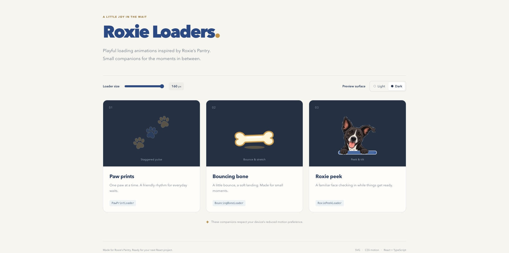

# Roxie Loaders

Three small, reusable loading indicators inspired by [Roxie's Pantry](https://roxiespantry.ethanwager.com). Built with React, TypeScript, Vite, SVG, CSS Modules, and native CSS animations.

The preview application displays all three animations with a shared size slider and light/dark background controls.

**[View Live Demo](https://ethan-wager.github.io/roxieLoadingSpinners/)**

## Preview



## Run locally

Use Node.js 22.12+ (or a newer supported Node release) and npm.

```sh
npm install
npm run dev
```

To run the available quality checks and preview the production build:

```sh
npm run typecheck
npm run lint
npm run build
npm run preview
```

The production output is generated in `dist/`. Dependencies are limited to the standard Vite React TypeScript starter, including its Oxlint configuration. No automated test suite is currently configured.

## Use the components

Copy the complete `src/components/loaders/` folder into a React project with CSS Modules support, then import the components from its barrel file:

```tsx
import {
  PawPrintLoader,
  BouncingBoneLoader,
  RoxiePeekLoader,
} from "./components/loaders";

export function LoadingExamples() {
  return (
    <>
      <PawPrintLoader size={48} label="Loading products" />
      <BouncingBoneLoader size={32} label="Saving changes" />
      <RoxiePeekLoader
        size={96}
        className="my-loader"
        label="Getting things ready"
      />
    </>
  );
}
```

All three components accept the same `LoaderProps` interface:

| Prop                 | Default     | Purpose                                                |
| -------------------- | ----------- | ------------------------------------------------------ |
| `size?: number`      | `64`        | Width and height in pixels; SVG scales proportionally. |
| `className?: string` | None        | Additional CSS class on the root element.              |
| `label?: string`     | `"Loading"` | Visually hidden loading status text.                   |

### Available loaders

- **PawPrintLoader:** Three paw prints pulse in sequence.
- **BouncingBoneLoader:** A cartoon bone bounces gently with squash/stretch and an animated shadow.
- **RoxiePeekLoader:** The original Roxie illustration peeks and tilts behind an edge, with her paws anchored over it. SVG clipping paths separate her portrait and paws from the image background and logo.

Each loader reserves a square viewport, runs independently, exposes `role="status"`, and hides decorative SVGs from screen readers.

Animations respect `prefers-reduced-motion`, displaying a static pose when reduced motion is requested.

Styles and colors are component-local and designed to work on both light and dark backgrounds.

Render a loader while work is pending and remove it when the operation finishes. Avoid multiple screen-reader announcements for the same operation.

## Visual reference and limitations

The blue, cream, and gold palette is inspired by the original Roxie's Pantry application.

`RoxiePeekLoader` uses an unchanged, locally bundled image of the original Roxie illustration. SVG clipping paths separate her face and paws so they can be animated independently while preserving the original character design.

The source JPEG is relatively small, so it may appear slightly soft at larger sizes or retain a faint background fringe. A higher-resolution transparent illustration would improve rendering quality.

Clipping coordinates are calibrated to the current **221 × 153 px** source image and its crop. Artwork dimensions and outlines are maintained in `src/components/loaders/assets/roxie-clips.ts`.

Replacing or cropping the image requires reviewing the clipping paths, viewport, edge placement, and animation coordinates.

A higher-resolution image with identical framing can retain the existing rendered dimensions and clipping coordinates. Changing the component's `size` prop scales the entire loader without requiring coordinate changes.

When reusing `RoxiePeekLoader`, copy its associated assets along with the component.
